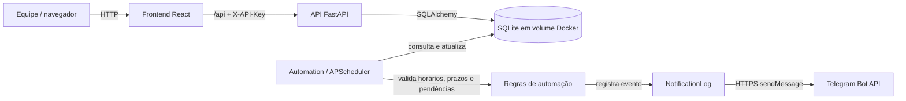

# KitchenCheck

Sistema de gerenciamento e automação de checklists operacionais para cozinhas
profissionais. O projeto foi desenvolvido como trabalho prático da disciplina
Automação e Programabilidade em Redes.

## 1. Sobre o projeto

Rotinas de abertura, operação e fechamento dependem de várias tarefas que podem
ser esquecidas ou registradas manualmente de formas diferentes. O KitchenCheck
organiza essas rotinas, permite acompanhar sua execução e alerta a equipe quando
há tarefas obrigatórias pendentes ou quando uma rotina é concluída.

O sistema mantém o histórico das execuções, calcula o percentual de conclusão e
automatiza notificações pelo Telegram. O objetivo é dar visibilidade às
pendências e reduzir falhas no acompanhamento operacional.

## 2. Arquitetura e fluxo de funcionamento



### Fluxo da automação

1. O APScheduler executa o monitoramento no intervalo configurado
   (um minuto por padrão).
2. O motor consulta checklists ativos e execuções abertas no SQLite.
3. Compara os horários e prazos no fuso operacional, atualiza os estados e
   calcula pendências e conclusão.
4. Registra eventos de notificação no banco. Chaves de evento únicas evitam
   criar notificações duplicadas.
5. O serviço de notificações envia os eventos pendentes ao Telegram por HTTPS.
   Falhas temporárias são mantidas para novas tentativas.

Os horários são armazenados em UTC quando representam instantes; o fuso
operacional é configurável. Uma execução só é concluída quando todas as tarefas
obrigatórias estão concluídas; tarefas opcionais não bloqueiam a finalização.

## 3. Tecnologias e integrações

- Python 3.12, FastAPI, Uvicorn, SQLAlchemy, SQLite e Pydantic.
- APScheduler para o monitoramento periódico.
- HTTPX para comunicação HTTPS com a Telegram Bot API.
- React, TypeScript, Vite, Tailwind CSS, Axios, React Router, Lucide React e
  Recharts no painel web.
- Docker e Docker Compose para executar API, automação e frontend. API e
  automação compartilham um volume persistente para o banco SQLite.
- Pytest para os testes automatizados.

## 4. Pré-requisitos e execução

### Pré-requisitos

- Docker Desktop com Docker Compose.
- Uma chave administrativa para proteger a API.
- Para receber mensagens: um bot do Telegram e o `chat ID` de destino.

### Configuração

O Compose lê o arquivo `.env` na raiz do projeto. Crie ou edite esse arquivo e
defina as variáveis abaixo. Os valores de credenciais devem ser substituídos
pelos seus próprios; não use os exemplos como credenciais válidas.

```dotenv
APP_NAME=KitchenCheck
ENVIRONMENT=development
DATABASE_URL=sqlite:////app/data/kitchencheck.db
LOG_LEVEL=INFO
API_PORT=8000
FRONTEND_PORT=5173
ADMIN_API_KEY=substitua_por_uma_chave_forte
OPERATION_TIMEZONE=America/Sao_Paulo
AUTOMATION_INTERVAL_MINUTES=1
TELEGRAM_BOT_TOKEN=substitua_pelo_token_do_bot
TELEGRAM_CHAT_ID=substitua_pelo_chat_id
TELEGRAM_REQUEST_TIMEOUT_SECONDS=10
TELEGRAM_RETRY_ATTEMPTS=3
TELEGRAM_RETRY_DELAY_SECONDS=1
TELEGRAM_DAILY_SUMMARY_TIME=23:00
```

O `ADMIN_API_KEY` precisa estar preenchido para usar os endpoints administrativos.
O `TELEGRAM_BOT_TOKEN` e o `TELEGRAM_CHAT_ID` são necessários para enviar
mensagens. Inicie uma conversa com o bot (`/start`) ou adicione-o ao grupo
destino antes de testar.

**Segurança:** não publique nem compartilhe o arquivo `.env`. Ele deve permanecer
ignorado pelo Git. O `.env.example` destinado ao repositório público deve conter
somente valores fictícios; confira e substitua qualquer credencial real antes
de publicar. Credenciais que já tenham sido expostas devem ser revogadas e
rotacionadas.

### Inicialização com Docker

Na raiz do projeto:

```powershell
docker compose up -d --build
```

Acesse:

- Painel: <http://localhost:5173>
- Documentação interativa da API: <http://localhost:8000/docs>
- Verificação de saúde da API: <http://localhost:8000/health>

No painel, informe o mesmo valor configurado em `ADMIN_API_KEY`. As operações
administrativas da API usam o cabeçalho `X-API-Key`.

Comandos úteis:

```powershell
docker compose ps
docker compose logs -f api automation frontend
docker compose down
```

O volume Docker mantém o banco depois que os containers são parados. Evite
`docker compose down -v` se quiser preservar os dados: a opção `-v` remove os
volumes, inclusive o banco persistente.

### Testes automatizados

Com Python 3.12 instalado, em PowerShell:

```powershell
py -3.12 -m venv .venv
.\.venv\Scripts\Activate.ps1
python -m pip install -r requirements.txt
python -m pytest -q
```

Os testes usam bancos temporários e mocks para não depender de uma conta real
do Telegram.

### Verificação manual do motor

O serviço `automation` executa verificações automaticamente. Para disparar uma
verificação única:

```powershell
docker compose exec -T automation python -m app.automation --run-once
```

Essa execução processa eventos pendentes e pode enviar mensagens reais ao bot.
Use somente depois de conferir as credenciais e o chat de destino.

## 5. Funcionalidades e demonstração

O painel permite gerenciar checklists e tarefas, iniciar execuções, acompanhar
percentuais de conclusão e consultar o histórico. A API valida os dados e exige
chave administrativa nas rotas de gerenciamento.

O bot pode enviar notificações quando:

- uma execução é iniciada;
- uma execução passa do prazo com tarefas obrigatórias pendentes;
- todas as tarefas obrigatórias são concluídas;
- chega o horário configurado para o resumo diário.

Criar ou editar um checklist, sem iniciar uma execução, não envia uma mensagem.

**Evidência da demonstração:** antes da entrega, adicione uma captura de tela ou
GIF do painel e uma captura da mensagem recebida no Telegram. Faça a captura
depois de testar o fluxo com credenciais próprias e oculte chaves, tokens e
informações privadas. Não inclua uma imagem ilustrativa como se fosse resultado
de uma execução real.

## 6. Melhorias futuras

- Perfis de acesso para diferentes funções da equipe.
- Relatórios exportáveis por período e por tipo de checklist.
- Suporte a múltiplas cozinhas/unidades e configuração de suas rotinas.

## API principal

As rotas abaixo, exceto `/health`, exigem o cabeçalho `X-API-Key`.

| Método | Rota | Descrição |
|---|---|---|
| `POST` / `GET` | `/checklists` | Criar e listar checklists |
| `GET` / `PUT` / `DELETE` | `/checklists/{id}` | Consultar, atualizar e excluir checklist |
| `POST` / `GET` | `/checklists/{id}/tasks` | Adicionar e listar tarefas |
| `PUT` / `DELETE` | `/tasks/{id}` | Atualizar e excluir tarefa |
| `POST` | `/checklists/{id}/executions` | Iniciar execução |
| `GET` | `/executions` | Listar execuções (`skip` e `limit`) |
| `GET` | `/executions/{id}` | Consultar execução |
| `PATCH` | `/executions/{id}/tasks/{task_id}` | Marcar tarefa como concluída |